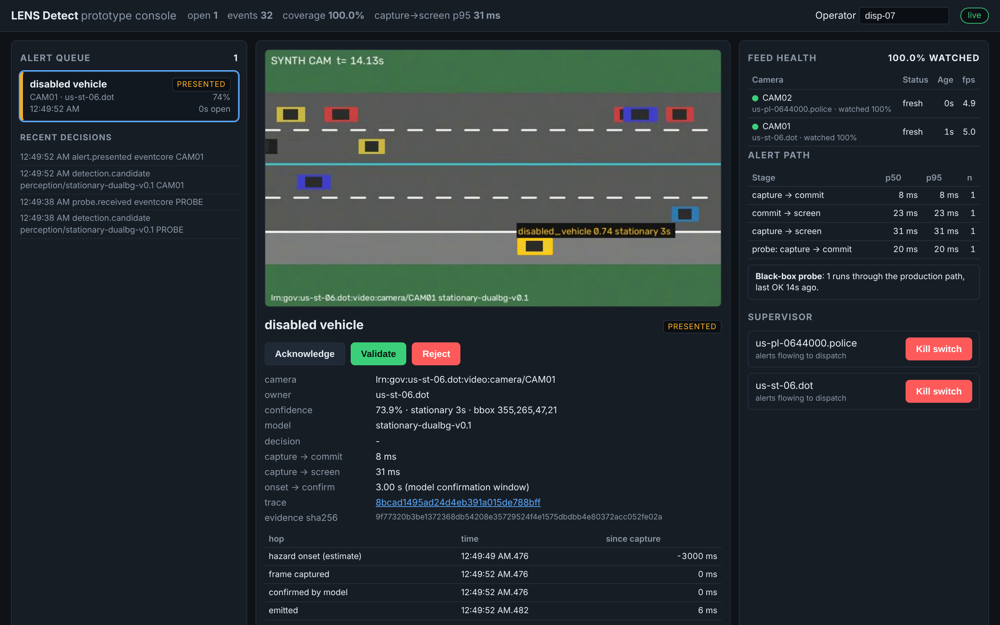

# lensy: an alert-path prototype for LENS Detect

Supporting technical work for the LENS VP Engineering take-home. It is a small,
runnable version of the alert path described in Exercise 1 of the written
answers, built to test the claims there rather than to be a product:

- the **event log is the system of record** and every projection is rebuilt from it;
- an alert is **committed before it is shown**, and delivery is idempotent;
- **silence is made visible**: frozen feeds, stale feeds, stale consoles, unacknowledged alerts, and a black-box probe that replays a known hazard through the production path;
- **latency is measured to the operator's screen**, not to the server;
- a supervisor **kill switch** exists before launch, not after the first bad night;
- agency and owner are on every record, using the naming scheme from Exercise 4.

```
camera / file ──► perception (Python, OpenCV) ──► event core (Go) ──► console (TypeScript)
                  feed adapter                    append-only log      SSE stream
                  dual-background detector        state machine        ack / validate / dispatch
                  evidence still + sha256         watchdog, probe lane render-time report back
                  heartbeats                      metrics, raw log API  kill switch, stale banner
```



## Run it on live Caltrans cameras

```bash
scripts/demo.sh live
```

This starts the same core and console, the synthetic CAM01 (so there is a
guaranteed hazard to click on), the probe, and one perception worker per
camera in `perception/cameras.json`: four public Caltrans District 7 HLS
streams in the CHP Los Angeles Communications Center's territory.

| Camera | View | Region of interest |
|---|---|---|
| D7-CCTV-196 | I-110 south at the Avenue 26 off-ramp | right shoulder and median shoulder |
| D7-CCTV-319 | I-105 east at Bellflower Blvd | right shoulder along the k-rail |
| D7-CCTV-954 | I-710 north, north of SR-47 | left shoulder; right roadway's right shoulder |
| D7-CCTV-793 | I-110 north at the John Gibson Blvd on-ramp | mainline right shoulder |

Regions were drawn by eye on one still per camera and live in the config as
fractions of the frame; `launch.py --debug-dir` writes a tinted frame per
camera so you can check them. Live cameras use a 60 s confirmation window and
3 analyzed frames per second. Expect a stopped vehicle on a busy corridor
within an hour, and expect some alerts to be wrong: a maintenance truck, a
car stopped in the gore, a ramp queue that spills into the region. That is
what the validate / reject step and the alert budget are for.

What running against the real portal taught the prototype, all of which is
now handled in code:

- **The inventory lies.** `perception/caltrans.py` reads the district JSON. On the day this was built it advertised 418 District 7 cameras as in service with a stream URL; 146 actually served a playlist, 34 answered 403, and the rest did not answer. The adapter probes before it trusts. At least one stream (listed as CCTV-183 on I-110) shows a different camera's own caption (CAM 662, SR-134 at Glendale Ave).
- **HLS arrives in 10-second bursts.** Caltrans serves 10 s segments, so frames come in groups and the newest frame is already 10 to 30 s old when it is decoded. Heartbeats therefore run on their own thread and report frame age separately, and the detector reasons on the stream's media clock, not the wall clock. For a real deployment this is the argument for RTSP or SRT from the camera owner rather than a public HLS edge.
- **Opening a stream fails sometimes.** The adapter retries with backoff; the launcher restarts a worker that dies; the core reports the gap as not watched either way.
- **Burned-in overlays are stationary objects.** Caltrans stamps a timestamp top-right and a caption bottom-left. Both are masked per camera.

Rights: the streams and inventory are published by Caltrans for public use. The repository contains no frames from them; evidence stills and region-check images are written only to the ignored `data/` directory when you run it.

## Run it on synthetic video

Requirements: Go 1.22+, Node 18+ with TypeScript (`npm install` in `console/`, or a global `tsc`), Python 3.10+ with `opencv-python-headless` and `numpy`.

```bash
pip install opencv-python-headless numpy
```

```bash
scripts/demo.sh
```

Then open <http://localhost:8080>, type an operator id, and watch:

1. **CAM01** (state DOT camera): a car pulls onto the shoulder at about 10 s. Three seconds later a `disabled_vehicle` alert appears with an evidence still, confidence, model version, and a per-hop timeline from frame capture to your screen. Acknowledge, validate, dispatch, close. Each decision is attributed to you and written to the log.
2. **CAM02** (city police camera): the feed freezes at 25 s. The feed panel turns amber ("frozen"), then red ("stale") when the worker exits at 40 s. Effective coverage in the header drops. Nothing about this camera is quiet.
3. **Probe**: every 60 s a recorded hazard clip replays through the same detector, API and log, flagged `probe=true`. It is counted in the "Alert path" panel and never appears in the queue. If it stops completing, the panel says so.
4. **Kill switch**: press it for an agency. Detections keep being committed (the record is complete) but are marked `suppressed` and never shown. Release it and alerts flow again.
5. **Stale console**: stop the core (`scripts/demo.sh stop`) and the console shows a red banner within 10 s telling the dispatcher to fall back to standard procedure.

Stop everything with `scripts/demo.sh stop`. Tests: `make test`.

Useful endpoints:

| URL | What |
|---|---|
| `/v1/stream` | server-sent events: snapshot, then every committed event |
| `/v1/alerts`, `/v1/alerts?all=1` | operator queue (probes never appear) |
| `/v1/feeds` | feed health with time attributed to fresh / frozen / stale |
| `/v1/metrics` | coverage, latency percentiles per stage, probe status, kill switches |
| `/metrics` | the same in Prometheus text format |
| `/v1/events?trace_id=…` | the raw log, filterable by trace: every hop of one alert |

## What each piece demonstrates

| Design element (written answers) | Where it is in the prototype |
|---|---|
| Feed adapter contract: source in, timestamped frames and a health signal out | `perception/adapters.py`. Files, RTSP and HLS streams go through one `Frame` iterator; `perception/caltrans.py` turns a DOT portal into config. Timestamps are taken at ingest; camera clocks are not trusted. |
| Perception emits a candidate stamped with its model version | `perception/detector.py`. A dual-background stationary-object detector stands in for the Specific AI model. Explainable, deterministic, versioned. |
| Event core as durable, append-only record | `eventcore/log.go`, `eventcore/state.go`. JSONL log, fsync per event, projection rebuilt by replay at startup. `TestReplayRebuildsState` proves it. |
| Commit before notify; at-least-once delivery with idempotency | `eventcore/api.go` `handleDetection`. 201 is returned only after fsync; a repeat `dedupe_key` returns the existing alert. |
| Every alert traceable to frames, model, configuration and decision | `trace_id` minted at ingest; evidence still with SHA-256 verified on receipt; `actor` on every event; `/v1/events?trace_id=`. |
| Alert lifecycle as a state machine | `transitions` table in `api.go`. Illegal transitions are refused with 409. Decisions without an operator id are refused. |
| Silent blindness is the top failure mode | Freeze and scene-change detection in the detector; heartbeat watchdog turns silence into `feed.stale` events; frame age is reported separately from liveness; coverage is computed from time actually watched. |
| Black-box probe | `perception/probe.py`. Same clip, same path, flagged. The core keeps probes out of the queue, out of counts, and refuses actions on them. |
| Detected but unseen | Browser reports render time (`/rendered`); unacknowledged alerts are escalated by the watchdog; the console shows a stale banner when the stream dies. |
| Alert flood and the kill switch | `/v1/agencies/{agency}/killswitch`. Suppression is itself an event, attributed and reasoned. |
| Latency measured end to end at p50 / p95 / p99 | Per-stage windows in `state.go`: capture→commit, commit→screen, capture→screen, screen→acknowledge, capture→dispatch. |
| Agency and owner on every record; names identify, relationships govern | Cameras are `lrn:gov:us-st-06.dot:video:camera/D7-CCTV-196`; agencies are `{country}-{level}-{fips}.{agency}`. Schemas in `schema/`. |
| Replay harness as release gate | `perception/test_detector.py` replays labeled synthetic clips: must find the hazard, must not alarm on clear traffic, must report a frozen feed, must map boxes back to full resolution. |
| Agency differences as configuration, never branches in code | `perception/cameras.json`: per-camera source, label, regions, masks and windows. The worker is the same binary for every camera. |
| Developer Center starts as read access to the same events | `/v1/events` is the log the system itself trusts, nothing else. |

## What is deliberately not here

- **Kafka and gRPC.** The event core talks HTTP and JSON so the prototype runs with no infrastructure. The boundaries are the same ones a Kafka topic per `{partition}.{domain}.{event}.v{n}` would carry; the schemas in `schema/` are what would be registered.
- **A trained model.** The detector is classical computer vision chosen because it is explainable in an interview and testable in CI. The hazard module contract (model, confirmation rule, evidence template, routing) is what the real Specific AI module would plug into.
- **Authentication, SSO, MFA, row-level security, grants.** Operator identity is a typed name. The naming scheme is present; the grant model from Exercise 4 is not implemented.
- **Multi-cell deployment, warm standby, GPU scheduling.** One process each.
- **A labeled truth for the live cameras.** Precision on the Caltrans feeds is unknown until dispatch-style review labels a sample, which is the shadow-mode step in Exercise 2. The synthetic clips are the only labeled footage here.

## Layout

```
eventcore/     Go: log.go (append-only), state.go (projection, metrics), api.go (HTTP), core.go (commit, fan-out, watchdog)
perception/    Python: adapters.py, detector.py, emitter.py, main.py (worker), launch.py, probe.py, caltrans.py, cameras.json, synth.py, test_detector.py
console/       TypeScript: src/app.ts, index.html, styles.css  (no framework, compiled with tsc)
schema/        detection.v1.json, event.v1.json
scripts/       demo.sh
docs/          screenshots
```

## Measured on the demo

One container, synthetic 640×360 video, 5 analyzed frames per second, console open before the hazard:

| Stage | Measured |
|---|---|
| hazard onset → model confirmation | 3.0 s (configured window) |
| frame capture → durable commit | 8 ms |
| commit → painted on operator screen | 23 ms |
| frame capture → operator screen | 31 ms |
| CAM02 freeze reported after | 2 s of identical frames |
| CAM02 declared stale after | 5 s of heartbeat silence |
| console stale banner after core stop | under 10 s |

The time that matters, hazard onset to officer dispatched, is dominated by the confirmation window and the human, which is the point made in Exercise 3. When no console was open, the same metric honestly read 83 s: nobody saw it.

Screenshots in `docs/`: the alert view, the feed panel with CAM02 frozen and then stale, and the stale-connection banner.
